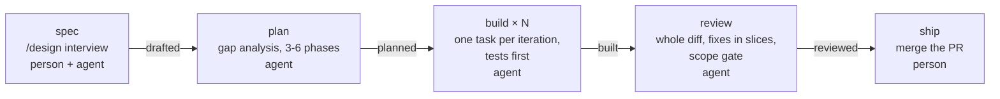
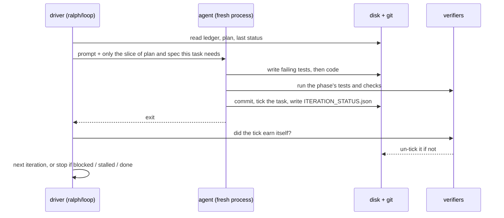

# ralph-autonomous

A drop-in kit for **spec-driven autonomous delivery** with Claude Code. A person writes a spec with an
agent's help. The agent then plans it, builds it and reviews it in short loops, each starting from a
fresh context. A detached queue runner carries a list of specs through those loops overnight, and
small scripts check every claim the agent makes before it counts.

It is a generic extraction of a setup that has run in production for months and shipped more than a
hundred specs for one product team. Nothing in it depends on a particular product,
language or framework. Your test command, your lint command and your standards are configuration.

## Why it works

Two ideas carry the whole design.

1. **An agent with an empty head cannot drift.** Every iteration is a new process that reads its state
   from disk: the spec, the plan, a status file, git. Nothing important lives in a context window, so a
   crash, a reboot or a bad iteration costs one iteration, not the run.
2. **An agent's claim is not evidence.** "This phase is done", "this test proves the requirement", "the
   base branch was already broken": each has a script that checks it against the files, the tests or
   git, and undoes the claim if it does not hold.

The loop technique itself ("Ralph") is Geoffrey Huntley's: run a coding agent in a loop against a
prompt and files on disk. This kit is one team's answer to what it takes to leave that running
unattended on a real codebase: specs as contracts, verifiers, a ledger, a queue, and rules for when to
stop and ask a person.

## The pipeline



| Stage | Who | What happens | Checked by | Ledger state after |
|-------|-----|--------------|------------|--------------------|
| spec | a person, with `/design` | Interview, codebase research, a written contract: problem, scope, design, phases with acceptance tests | `lint-spec` | `drafted` |
| plan | the agent | Gap analysis, base-branch health, a plan of 3-6 phases ending in an Exit Gate | `verify-plan-completeness`: every requirement lands in a task that names its files | `planned` |
| build | the agent, many iterations | One task per iteration: failing tests first, implementation, commit | `verify-plan-ticks` and `verify-acceptance-bindings` on every ticked phase; the full sweep at the Exit Gate | `built` |
| review | the agent | One pass over the whole diff, fixes in slices, findings sorted by whether they are in scope | the configured gates, a review subagent, a review cap | `reviewed` |
| ship | a person | Merges the change. Approvals and waivers carry a person's name. | | `shipped` |

## One iteration



## What is automated and what is yours

- **Automated:** planning, building, reviewing, the checks on all three, queueing many specs,
  recovering from crashes and reboots, keeping the machine awake, telemetry.
- **Yours:** deciding what the feature is (questions tagged `[product]`), signing approvals and
  waivers, merging and shipping, and reading what the loop parked for you when you return.
- **Deliberately not a manual gate:** the plan. The checks decide whether a plan covers its spec; you
  may read and edit it, but nothing waits for you.

## How it stays in bounds

### Scope: what it builds, what it files, and who widens a spec

The spec's Problem Statement, Scope and Success Criteria are a boundary the loops never widen. Every
finding from build or review is sorted before anyone acts on it:

| Finding | What happens |
|---------|--------------|
| **Inside** the spec's scope | Fixed now, properly, with a test. |
| **Outside, but ship-blocking** (this spec's deliverable would be unsafe or wrong without it) | Fixed now, and tagged `[REVIEW: SCOPE]` with the reason, so you can see every time it went outside the lines. |
| **Outside and pre-existing** (true before this spec touched anything) | **Not built.** Filed as a candidate spec in the plan, and as a Jira comment or linked issue when Jira is on, with the residual risk stated. |

Only a person widens a spec. If review keeps finding work, it stops after five passes and asks you one
batched question (accept the risk, file follow-up specs, or widen the spec), and the queue parks the spec
after eight review passes whatever happens.

### Decisions: who makes them, where they are written, how you review them

- **You** decide what the feature is, sign approvals and waivers, and take every outward-facing action.
- **The supervising skill** decides only what your written `standards/` or recorded decisions already
  decide, and tags each call `[REVIEW]` with the rule it used and how to undo it.
- **The loops** decide how to build (where code goes, which pattern) and record each call as a numbered
  decision (`D7`) in the plan with the rule behind it.

Everything lands in files that are committed with the work: the spec's Open Questions become a dated
decision log, the plan carries its decisions, commit messages carry the rest. When you come back, one
command lists it all, with what needs you first:

```bash
node scripts/ralph-decisions.mjs          # NEEDS YOU, DECIDED FOR YOU, DEFERRED
```

Mark a decision `[REVIEWED]` when you accept it; overturn it by changing the spec or plan and
re-queueing. [docs/DECISIONS.md](docs/DECISIONS.md) has the full decision rights, every record and the
review routine.

### Lanes: specs in parallel

One worktree runs one loop at a time. To build two or three independent specs at once, give each a
**lane**: a sibling git worktree on its own branch with its own queue and runner
(`node scripts/new-lane.mjs --name backend --base main`).

- **When:** independent specs that touch different files, a machine with room for another agent and test
  run, and an environment (ports, databases, test accounts) the lane can have to itself.
- **How to split:** by the files the specs touch, dependent specs in the same lane, never a lane from a
  lane. Two or three lanes, the integration worktree included.
- **Merging back:** after each spec reaches `reviewed`, one lane at a time, with a person's approval.
  Stop both runners, merge, keep the integration plan, merge the ledger row by row, verify, then sync
  the other lanes. `scripts/lane-merge-notes.mjs` prints the checklist.

[docs/LANES.md](docs/LANES.md) covers when to use them, environment isolation, every merge step and
what to expect to conflict.

### Jira: optional

With `tracker.provider: "none"` (the default) nothing mentions a tracker. With `"jira"` and the Atlassian
MCP server connected, each spec is bound to an issue (`/design` creates one or binds an existing key) and
the loops keep it current:

| When | Jira |
|------|------|
| `/design` saves the spec | moves to your "ready for development" status, comment with the spec path |
| First build iteration | moves to "in progress" |
| Exit Gate passes | moves to "review required", comment with phases done and each gate's result |
| Every review pass | comment: fixes applied, items left for a person, findings deferred as outside the spec |
| An out-of-scope finding worth tracking | a new linked issue |

Transitions are looked up by status name, so your workflow's names go in the config. The loops never
close, delete, reassign or reprioritise issues. If Jira is unreachable the loop keeps working, writes a
`JIRA DEGRADED` marker, and the commit hook refuses commits until the missed update is retried, so a
ticket is never silently left behind. Setup is in [GETTING_STARTED.md](GETTING_STARTED.md#12-optional-a-jira-tracker).

## What to expect

- A spec takes **dozens of iterations**, not a handful. Most of that is re-verifying, not writing code.
- **Review is the most expensive mode**: it runs on the largest model and reads the whole diff. The
  review cap and the scope audit exist to stop it running on.
- Real specs are **a few hundred lines** long. See [examples/specs/](examples/specs/) for one at
  realistic size.
- Most overnight stops are **environment problems**, not code: a test stack that is down, a VPN, a
  quota. The loop is only as autonomous as the environment its tests need.

## Quick start

```bash
# 1. Copy ralph/, scripts/, .githooks/, .claude/, standards/, templates/ and docs/ into your repository.
#    Merge into folders you already have; GETTING_STARTED.md step 1 says what to watch for.
cp templates/config.example.json ralph.config.json    # set your test, lint, typecheck, build commands
node scripts/install-hooks.mjs                        # git core.hooksPath -> .githooks (refuses to replace yours)
node scripts/ralph-doctor.mjs                         # node, git, agent CLI, config, hooks

# 2. Write a spec in Claude Code
/design "what you want built"

# 3. Run the loops one at a time (PowerShell: .\ralph\loop.ps1 plan 1 specs/my-spec.md)
./ralph/loop.sh plan   1  specs/my-spec.md
./ralph/loop.sh build  20 specs/my-spec.md
./ralph/loop.sh review 5  specs/my-spec.md

# ...or queue several and walk away: in Claude Code, "work autonomously through specs/a.md and specs/b.md"
node scripts/ralph-queue.cjs status
```

[GETTING_STARTED.md](GETTING_STARTED.md) walks through every step, from an empty checkout to a shipped
spec, including parallel lanes and the optional Jira tracker. Allow an hour for the first spec.

## Requirements

- **Claude Code** (`claude` on PATH). The kit is built around it: the driver reads its streaming output
  for telemetry, cost and usage-limit recovery, sets its headless options, and ships a Claude Code
  skill, commands, an agent and a hook. Another agent CLI that reads a prompt on stdin can be set with
  `agent.command` / `agent.args` (or `RALPH_AGENT_CMD`), and the loop will run, but without per-iteration
  telemetry and cost, usage-limit recovery or the headless safety options; model selection works if you
  set `agent.modelFlag` for that CLI. Treat that as a starting point for a port, not a supported mode.
- Node.js 20 or newer. No dependencies; nothing to install.
- Git (worktrees are used for base-branch health and lanes).
- Windows (PowerShell 5.1 or Git Bash), macOS or Linux.

## Safety

**Unattended runs skip permission prompts.** The default agent arguments include
`--dangerously-skip-permissions`, because an agent that stops to ask cannot work overnight. The agent
can run any command with your user's rights. So:

- Run it in a **sandbox, container or throwaway worktree** that holds only the code it should change,
  with no production credentials, no deploy tooling and no access to shared environments.
- Work on a **branch**, never on your integration branch, and keep the pull request a **draft** until
  you have read the result (every push to a ready PR runs your full CI).
- **Tag a checkpoint before a long run**: `git tag ralph-checkpoint-1`, so "undo everything the loop
  did" is `git reset --hard ralph-checkpoint-1` on that branch.
- The prompts forbid signing approvals, force pushes, infrastructure changes and skipping hooks. Those
  are instructions to the agent, not a sandbox: enforce what matters with your OS, your credentials and
  branch protection.
- `node scripts/ralph-queue.cjs stop` ends a queue run after the current invocation.

## What is in the box

```
ralph.config.json            your project's configuration (from templates/config.example.json)
ralph/                       the loop: loop.sh, loop.ps1 (thin launchers), lib/ (all policy, in Node),
                             PROMPT_plan/build/review.md, CONVENTIONS.md, AGENTS.md, TRACKER_jira.md, report.mjs
scripts/
  ralph-queue.cjs            detached queue runner (start | run | status | watch | stop)
  sweep.mjs                  the only process owner: starts, bounds and kills long jobs and their trees
  verify-plan-completeness.mjs   does every spec requirement land in a plan task with Files:?
  verify-plan-ticks.mjs          did each newly ticked phase earn its tick?
  verify-acceptance-bindings.mjs is every acceptance row bound to a real, asserting, un-skipped test?
  base-health.mjs                was the base branch already red, and did this spec make it redder?
  lint-spec.mjs                  structural lint of a spec
  verify-jira-sync.mjs           refuses commits while tracker sync is degraded (Jira only)
  ralph-decisions.mjs            everything decided, asked or deferred, for a person to review
  ralph-doctor.mjs, install-hooks.mjs, new-lane.mjs, lane-merge-notes.mjs
  hooks/require-agent-model.cjs  Claude Code hook: every subagent launch names its model
.githooks/pre-commit         tracker gate, then your own hooks.preCommit commands
.claude/                     /design, /feature-dev, the autonomous skill, the code-review agent, settings
standards/                   how to write your rules corpus, with one example rule
templates/                   spec, ledger, queue, config (with every key explained)
examples/                    a spec at realistic size
docs/                        overview.html, ARCHITECTURE, DECISIONS, LANES, RUNTIME, DRIVERS, SKILLS
test/                        node:test suites and a small worked example project
```

## Documentation

| Read | When |
|------|------|
| [docs/overview.html](docs/overview.html) | A one-page visual overview for sharing (GitHub shows its source; open it in a browser after cloning or downloading) |
| [GETTING_STARTED.md](GETTING_STARTED.md) | Setting it up and running your first spec |
| [docs/DECISIONS.md](docs/DECISIONS.md) | Who decides what, the scope rules, where decisions are recorded, how to review and overturn them |
| [docs/LANES.md](docs/LANES.md) | Running specs in parallel: when, how to split, environment isolation, merging back |
| [docs/ARCHITECTURE.md](docs/ARCHITECTURE.md) | How it fits together, and the failure each piece guards against |
| [ralph/CONVENTIONS.md](ralph/CONVENTIONS.md) | The rules the agent follows: phase sizing, verification tiers, formats |
| [docs/SKILLS.md](docs/SKILLS.md) | `/design`, the `autonomous` skill, `/feature-dev`, the review agent |
| [docs/RUNTIME.md](docs/RUNTIME.md), [docs/DRIVERS.md](docs/DRIVERS.md) | The queue runner, process owner and loop driver in detail |

## Tests

```bash
npm test          # every test/*.test.mjs with node --test
```

The suites use temporary directories and a fake agent; they never call a real model.
`test/fixtures/example-project` is a small project whose spec, plan, ledger and tests every verifier accepts.

## Credits and licence

The Ralph loop technique is Geoffrey Huntley's ([ghuntley.com/ralph](https://ghuntley.com/ralph/)).
This kit is released under the [MIT licence](LICENSE).
