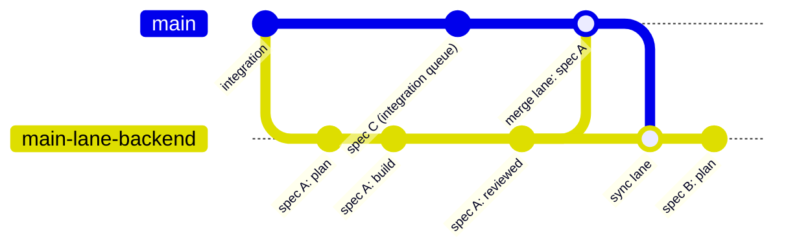

# Lanes: running specs in parallel

One working tree runs one loop at a time, because loops in the same tree share the git index, the live
plan and whatever test environment the checks use. A **lane** is a second (or third) working tree on its
own branch, with its own queue and runner, so two specs build at once. Lanes buy throughput; they cost
machine resources, an isolated environment per lane and a merge back for every spec.



## When to open a lane

Open one when **all** of these hold:

- The queue has specs that do not depend on each other and do not touch the same files.
- The machine has room: each lane runs its own agent, test runner and (if your tests need one) local
  stack. Budget a few GB of memory per lane, more if tests start browsers.
- Each lane can have its own environment (next section). If two lanes would share a database, a fixed
  port or a test account, do not open the second one.
- Someone will merge lanes back within a day or two of each spec finishing. A lane left for a week
  drifts far enough from the integration branch that the merge becomes its own project.

Keep it to **two or three lanes, the integration worktree included.** More than that is more than one
person can supervise, and the machine starts killing processes under memory pressure, which looks like
flaky tests. Never open a lane from another lane: it adds a second merge hop for no gain.

Stay serial in one worktree when specs depend on each other, when they touch the same module, or when
the queue is short enough to finish overnight anyway.

## How to split specs between lanes

- **By the files they touch.** Backend specs in one lane, frontend in another; or by service or package.
  Before starting, list the paths each spec's plan names under `Files:`; any path in two lanes is a merge
  conflict you have scheduled.
- **Dependent specs stay in the same lane, in order.** A lane is a queue; put "B builds on A" in one.
- **By environment needs.** Specs that need the same scarce resource (one end-to-end stack, one external
  test account) belong in the same lane.
- **The integration worktree keeps working too.** It holds the long-lived branch and its pull request,
  runs its own queue, and is where lanes merge back. Lanes always branch from it, never from each other.

## Creating a lane

```bash
node scripts/new-lane.mjs --name backend --base main --dry-run    # show the plan, change nothing
node scripts/new-lane.mjs --name backend --base main
```

This adds a sibling worktree `../<project>-lane-backend` on branch `main-lane-backend`, copies
`ralph.config.json` if it is not tracked, and creates the lane's queue. Then, in the lane:

1. Install dependencies and build.
2. **Give the lane its own environment**: its own ports (an offset no other worktree uses, set before
   the build if your frontend bakes ports in), its own databases (for example prefixed with the lane's
   branch name), its own test-environment credentials or lease. Keep these in an uncommitted local env
   file so they never merge back.
3. List the lane's specs in its `.claude-temp/ralph-queue/QUEUE.md`.
4. In the integration queue, mark each moved spec `- [!] specs/<name>.md — MOVED to lane backend` so the
   integration runner never picks it up.
5. Start the lane's runner: `node scripts/ralph-queue.cjs start` from the lane's directory, and its own
   `watch` from the supervising session.

Put lanes beside the integration worktree, not inside it, so build and test tooling never sees two
copies of the project.

## Merging a lane back

**When:** after a spec in the lane reaches `reviewed`, and before the lane starts its next spec if you
can. One spec per merge keeps each merge small and readable.

**Order:** one merge at a time. When two lanes are ready, merge them in the order they reached
`reviewed`. After every merge, the other lanes sync.

**Who:** a person approves the merge. The supervising skill may prepare it, but it asks first.

**Steps:**

1. **Stop both runners at a clean boundary.** `node scripts/ralph-queue.cjs stop` in the lane and in
   the integration worktree, and wait for the current invocation to finish. A loop commits whatever is
   in the index, including a half-done merge.
2. **Check the lane.** `node scripts/lane-merge-notes.mjs --lane main-lane-backend --base main --spec
   <name> --ledger-a .ralph/SPECS_LEDGER.md --ledger-b ../<project>-lane-backend/.ralph/SPECS_LEDGER.md`
   prints the checklist and the ledger rows that differ. Confirm the spec is `reviewed` and that the
   lane's plan is archived as `.ralph/IMPLEMENTATION_PLAN.<spec>.md`.
3. **Merge** the lane branch into the integration branch. Expect conflicts in the state files, and only
   those if the split was good:
   - `.ralph/IMPLEMENTATION_PLAN.md`: **keep the integration side.** The lane's plan is in its archive.
     Taking the lane's version silently replaces the integration branch's live plan with a plan for a
     different spec.
   - `.ralph/SPECS_LEDGER.md`: **merge row by row.** Take the lane's row for the spec it finished, keep
     every other row from the integration side. Never accept either side wholesale; rows get lost.
   - Anything in source code: resolve it as you would any merge, then run the affected checks.
4. **Verify** with the checks the spec's area needs (affected lint, typecheck and tests) before
   committing the merge. Commit, push.
5. **Update the integration queue**: `- [x] specs/<name>.md — reviewed via lane backend (<sha>)`.
6. **Sync every other lane**: merge the integration branch into each lane (merge, not rebase; the lanes'
   history is shared state), resolve the same state files the same way, and restart its runner.
7. Restart the integration runner.

## Tearing a lane down

When a lane's queue is empty and its last spec is merged: stop its runner and its local stack, check that
`git log main..main-lane-backend` is empty, then remove the worktree and branch by hand (`git worktree
remove`, `git branch -d`). Neither kit script deletes anything. Drop the lane's databases and free its
ports. Any spec still in the lane's queue goes back to `- [ ]` in the integration queue.

## What a fuller tool would do

The manual process works, but the same two files conflict on every merge. A production version of this
kit removed most of that friction with:

- **One plan file per spec** (`.ralph/IMPLEMENTATION_PLAN.<spec>.md`) instead of one live plan, so lanes
  write different files and there is nothing to keep or clobber.
- **A git merge driver for the ledger** that merges rows keyed by spec, cell by cell, and conflicts only
  when both sides changed the same cell of the same row. (Not `merge=union`, which duplicates rows.)
- **An owner in the `Active?` column** (the lane's branch) instead of a plain yes, so lanes never edit
  each other's rows.
- **A hold on the runner** that the merge sets and releases, instead of stopping and restarting.
- **One command** for create, status (including files touched by more than one lane), merge and sync.

If you run lanes often, those are the pieces worth building first.
